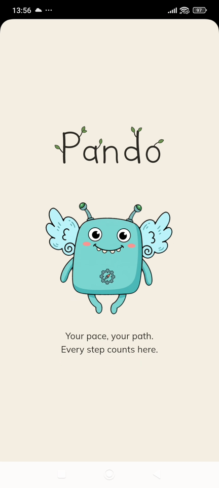
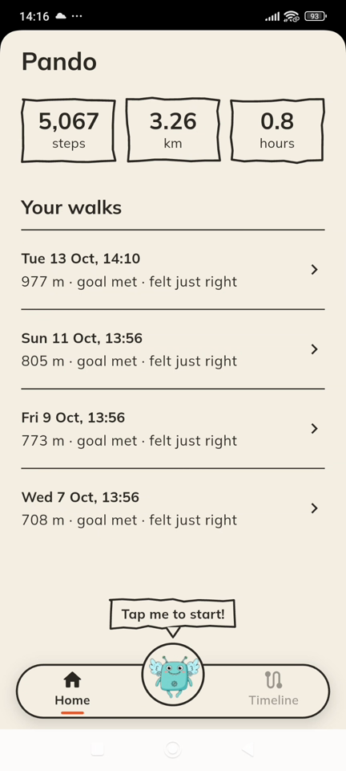
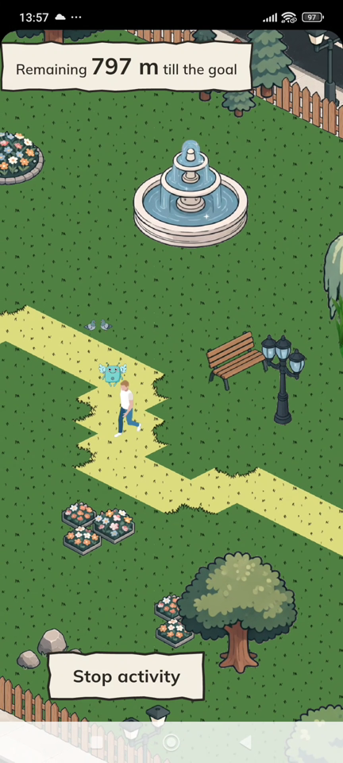
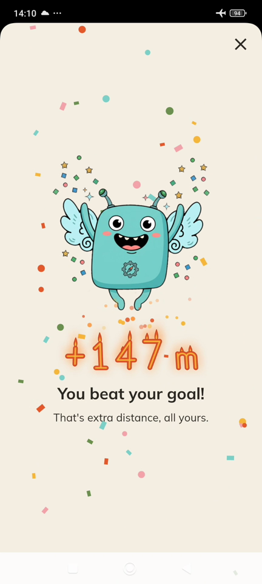
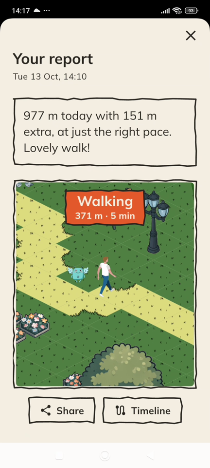
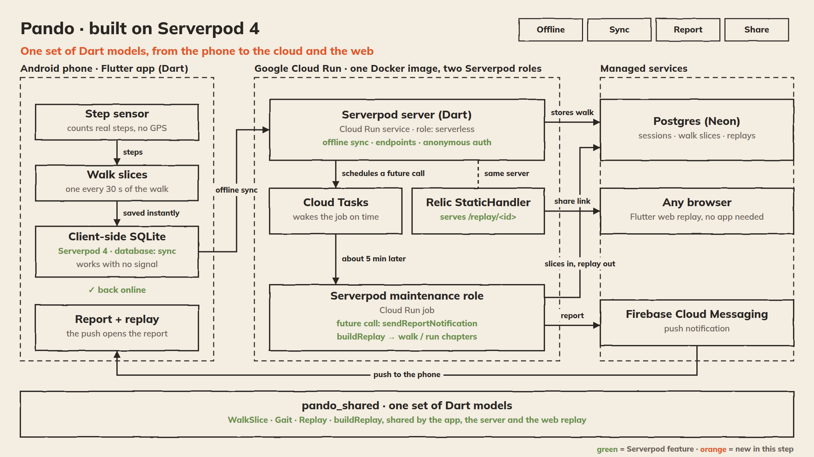
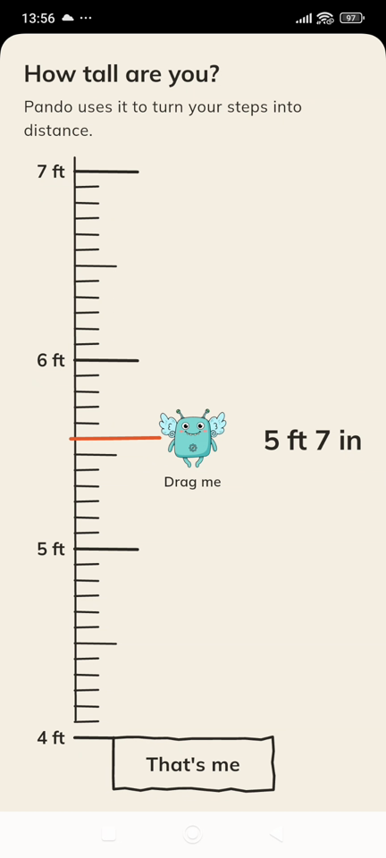
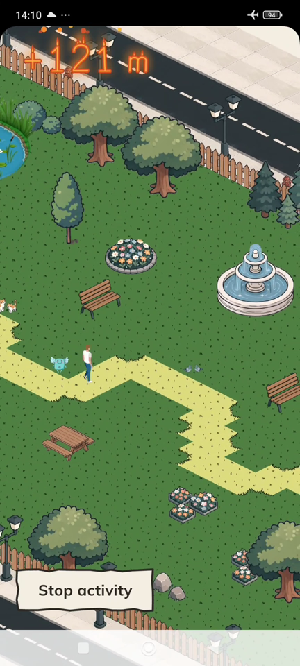
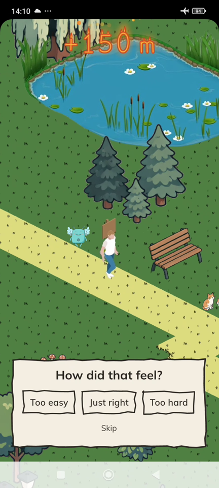
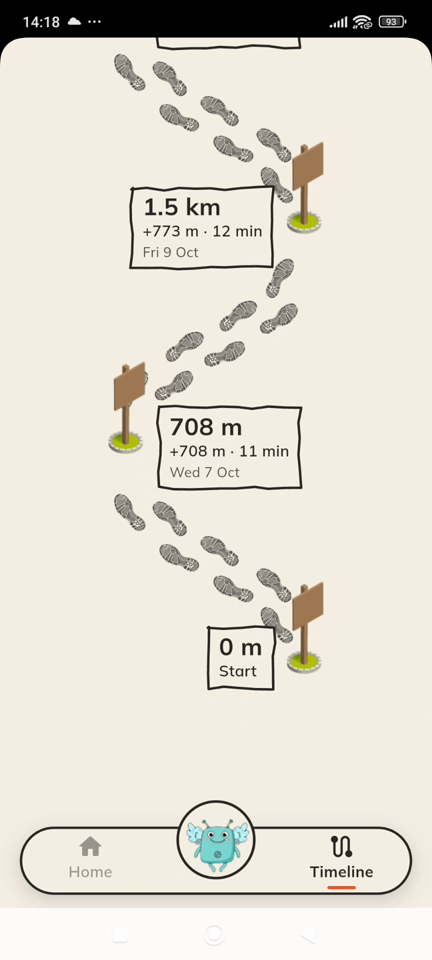

# Pando

**Your pace, your path. Every step counts here.**

Pando is a walking and running app for beginners who exercise in parks. It counts your real steps, with no GPS, and turns them into a runner crossing a cozy virtual park.

Built with Flutter and Serverpod 4 for "Build Something Real: The Serverpod Hackathon".

| | |
|---|---|
| Demo video (1:52) | https://youtu.be/_DqSh_mj4Z4 |
| A shared replay | https://pando-server-hbgj2wlv5a-as.a.run.app/replay/39b81784-88fa-4f93-82e0-c0c152ec663f |

<p>
  
  
  
  
  
</p>

## The problem

Most fitness apps push rigid plans: do this activity, for this long. That gets hard fast. It puts beginners off, especially people starting out heavier.

Many people walk or jog in parks. Their apps track them with GPS, and GPS struggles there:

- It jitters at slow paces.
- It loses you near tall buildings.
- Park signal is often weak or gone.

## The solution

| Pando does this | So that |
|---|---|
| Counts real steps with the phone's step sensor | Distance works with no GPS and no signal |
| Turns your height into a stride (height × 0.39) | Every step becomes real distance |
| Shows a runner moving through a park at your pace | Progress is something you watch, not a number you chase |
| Sets each goal from your last three activities, plus a little | The goal grows with you, never jumps |
| Has no streaks, badges or leaderboards | Nobody is shamed for a slow day |
| Works with the phone locked, even in airplane mode | You can just walk |
| Sends a gentle report 5 minutes after you stop | You rest first, then see how it went |
| Replays what really happened (walk, run, walk) | You see your effort, and can share it with a link |
| Keeps a timeline of wooden signs, one per activity | You see how far you've come |

## How it uses Serverpod 4

Serverpod carries an activity from the phone's offline database to the cloud, schedules its report, and serves its replay. The same Dart models run on the phone, the server and the web.

| Serverpod feature | Where Pando uses it |
|---|---|
| Client-side database (`database: client`, `database: sync`) | `WalkInProgress` and `WalkSlice` live in SQLite on the phone. An activity survives the app being killed and needs no signal. |
| Offline sync (experimental, `serverpod_offline_sync`) | When the phone is back online, walk slices sync to Postgres on their own. |
| Shared packages (`pando_shared`) | `WalkSlice`, `Gait`, `Replay` and `buildReplay` are one Dart package, used by the app, the server and the web replay. |
| Future calls | Saving an activity schedules `sendReportNotification` for 5 minutes later. |
| Maintenance role | A Cloud Run job runs the due future calls, builds the replay and sends the push. |
| Relic | A `StaticHandler` on the API server serves the replay web page at `/replay/<id>`. |
| Anonymous auth (`serverpod_auth_idp`) | No sign-up. Each phone gets an anonymous account. |
| Endpoints, models, migrations | `profile`, `session` and `replay` endpoints; Postgres tables from `.spy.yaml` models. |
| `serverpod start` and `serverpod_test` | Local server and database in one command. Server tests run against an embedded Postgres, no Docker. |

## Architecture



What happens to one activity:

| Step | Where | What happens |
|---|---|---|
| 1. Walk | Phone | The step sensor counts steps. Every 30 s a `WalkSlice` row goes into the phone's SQLite. |
| 2. Stop | Phone | You say how it felt. The activity is queued, even offline. |
| 3. Sync | Phone → Cloud Run → Postgres | Back online, offline sync uploads the slices. `session.save` stores the activity. |
| 4. Schedule | Cloud Run service | Serverpod schedules a future call. A Cloud Tasks alarm is set for the same time. |
| 5. Report | Cloud Run job | Cloud Tasks starts the job (maintenance role). It runs the future call: reads the slices, runs `buildReplay`, saves the replay, sends the push. |
| 6. Notify | Firebase Cloud Messaging | The push opens the report and its replay. |
| 7. Share | Relic on Cloud Run | The share link serves the Flutter web replay. Friends watch it in any browser, no app needed. |

How the replay is built: each 30 s slice gets a pace in steps per minute. At 130 or more it counts as running. Slices next to a run count as running down to 115, since a run rarely starts on a slice edge. Neighbouring slices join into chapters (walk, run, walk), and runs get more screen time so they don't flash by.

### Stack

| Part | Tech |
|---|---|
| App | Flutter (Android), Flame + `flame_tiled` for the park, `pedometer` for steps |
| Backend | Serverpod 4 (Dart) |
| Hosting | Google Cloud Run: one Docker image, two roles (`serverless` service, `maintenance` job) |
| Scheduling | Cloud Tasks wakes the job when a report is due |
| Database | Postgres on Neon |
| Push | Firebase Cloud Messaging |
| Secrets | Secret Manager, passed in as `SERVERPOD_*` env vars |

Why Cloud Run and not Serverpod Cloud: this project ran on existing Google Cloud credits, next to Firebase in the same project.

## More screens

<p>
  
  
  
  
</p>

## Repo layout

| Folder | What |
|---|---|
| `pando_flutter/` | The Android app |
| `pando_server/` | The Serverpod server |
| `pando_shared/` | Dart models and logic shared by the app, server and web replay |
| `pando_client/` | Client code generated by Serverpod (don't edit) |

## Run it locally

Needs Flutter, the Serverpod CLI (`serverpod`), and an Android phone on the same Wi-Fi as your computer. The licensed art is not in the repo (see [Art](#art)), so add it first.

```bash
cd pando_server && serverpod start --no-flutter          # local Postgres, migrations, port 8080
cd pando_flutter && flutter run --dart-define=SERVER_URL=http://<your-laptop-ip>:8080/
```

Optional build flags:

| Flag | Effect |
|---|---|
| `--dart-define=DEMO=true` | Long-press "Your walks" to seed three past walks |
| `--dart-define=TEST_GOAL_STEPS=30` | A tiny goal for indoor testing |

Push notifications need your own Firebase project (`flutterfire configure`) and a service account key at `pando_server/config/service-account.json` (gitignored). Without the key, the server only logs pushes, and the report opens from the Home row after 5 minutes.

## Art

The park, runner, mascot and sign art is licensed and **not in this repo** (`pando_flutter/assets/art/` is gitignored). See `CREDITS.md` for the sources. The lettering SVGs in `pando_flutter/assets/lettering/` were made for Pando.
